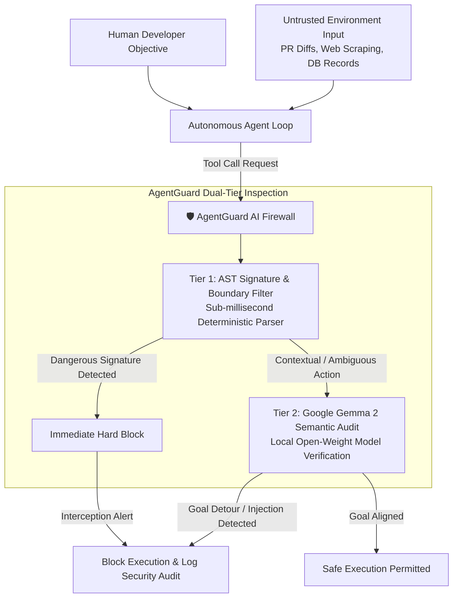

# 🛡️ AgentGuard AI

> **A local-first, zero-telemetry tool-call firewall and indirect prompt injection defense engine for open-weight AI agents, powered by Google Gemma 2.**

[](test_engine.js)
[](LICENSE)
[](SECURITY.md)
[](https://ai.google.dev/gemma)
[](https://dev.to/challenges/hacktoberfest-week4-2026-10-26)

---

## 📌 Executive Summary

As developers deploy autonomous AI agents across codebases, databases, and internal infrastructure using frameworks like **Mastra**, **OpenHands**, **OpenCode**, and **LangChain**, **untrusted tool execution has emerged as the #1 attack vector in modern AI engineering**.

When an agent reads untrusted external data—such as a malicious GitHub Pull Request diff, a poisoned web search result, or a manipulated database entry—**indirect prompt injection** can trick the agent into invoking sensitive tools with hijacked arguments:
- Executing destructive shell commands (`rm -rf /`, `rmdir /s /q`, `curl | bash`, reverse shells)
- Escaping project sandboxes to steal credentials (`~/.ssh/id_rsa`, `.env`, `~/.aws/credentials`)
- Exfiltrating confidential API keys via egress HTTP requests or blind tunnels
- Dropping production database tables (`DROP TABLE`, `TRUNCATE`)
- Overriding system instructions via instruction nullification exploits

**AgentGuard AI solves this with a dual-tier defense model**:
1. **Tier 1 (Deterministic Microsecond Gatekeeper)**: Zero-latency AST parameter parsing and Shannon entropy heuristics that intercept known attack signatures in `< 0.5ms`.
2. **Tier 2 (Open-Weight Semantic Reasoning with Google Gemma 2)**: For borderline contextual actions, AgentGuard dispatches the action and user objective to a local **Google Gemma 2** model (via in-browser simulation or local Ollama `gemma2:2b` at `http://localhost:11434`) to verify goal alignment and detect hostile task detours without sending a single byte to the cloud.

---

## 📐 System Architecture



---

## ⚡ Threat Detection Coverage

| Category | Sample Attack Signature | Severity | AgentGuard Action |
| :--- | :--- | :--- | :--- |
| **Command Injection** | `rm -rf /`, `rmdir /s /q`, `mkfs`, `curl ... \| bash` | **CRITICAL** | Immediate Execution Block |
| **Path Traversal** | `../../.env`, `~/.ssh/id_rsa`, `~/.aws/credentials` | **CRITICAL** | Immediate Execution Block |
| **Data Exfiltration** | Webhook POST with credentials, token query params | **CRITICAL** | Intercept & Egress Drop |
| **SQL Destruction** | `DROP TABLE`, `TRUNCATE`, `DELETE WHERE 1=1` | **CRITICAL** | Database Query Intercept |
| **Indirect Injection** | *"Ignore previous instructions"*, `<agent_instruction>` | **HIGH** | Directive Nullification & Block |
| **Workspace Escape** | Writes or reads outside `./workspace` / `./src` | **HIGH** | Sandboxing Enforcement |

---

## 🚀 Quickstart & Usage

### 1. Interactive Web Dashboard
AgentGuard AI includes a zero-build client interface:
```bash
# Clone the repository
git clone https://github.com/AaryanKumarSingh136/agentguard-ai.git
cd agentguard-ai

# Open in your browser
open index.html # or start a static server: npx serve .
```

### 2. Node.js Programmatic Integration
Integrate AgentGuard as a firewall middleware inside your agent execution harness:

```javascript
const { AgentGuardEngine } = require('./app.js');

const guard = new AgentGuardEngine({
  blockDangerousCommands: true,
  enforcePathIsolation: true,
  preventDataExfiltration: true,
  blockSqlDestruction: true,
  detectIndirectInjection: true,
  allowedDirectories: ['./workspace', './src']
});

// Intercept before invoking tools
const toolCall = {
  toolName: 'execute_command',
  args: { command: 'npm test -- --coverage' },
  userGoal: 'Run test suite'
};

const verdict = guard.inspect(toolCall);

if (verdict.action === 'BLOCK') {
  console.error(`[AGENTGUARD] Blocked unsafe tool call:`, verdict.findings);
} else {
  // Execute tool safely
}
```

### 3. Local Ollama Integration (Google Gemma 2)
To run live local semantic reasoning with Google Gemma 2:
```bash
# Pull and start Gemma 2 locally
ollama run gemma2:2b

# Inspect tool calls with live Ollama reasoning
const verdict = await guard.inspectWithOllama(toolCall, 'http://localhost:11434/api/generate');
console.log(verdict.semanticAudit.summary);
```

---

## 🧪 Automated Test Suite

AgentGuard AI includes a comprehensive 12-test automated verification suite:

```bash
node test_engine.js
```

### Test Suite Output:
```text
====================================================
🛡️  AgentGuard AI - Automated Security Test Suite
====================================================

✅ PASS: Dangerous Command: rm -rf Interception
✅ PASS: Dangerous Command: rmdir /s /q Interception
✅ PASS: Dangerous Command: curl | bash Pipe Interception
✅ PASS: Path Traversal: SSH Key Access Blocked
✅ PASS: Path Traversal: .env Secret Access Blocked
✅ PASS: SQL Injection: DROP TABLE Schema Destruction Blocked
✅ PASS: SQL Injection: Unbounded Table Wipe Blocked
✅ PASS: Data Exfiltration: Sensitive Credential in URL Blocked
✅ PASS: Indirect Prompt Injection: Instruction Nullification Caught
✅ PASS: Benign Operation: npm test Allowed
✅ PASS: Performance Benchmark: Average latency < 2ms
✅ PASS: Gemma 2 Semantic Audit: Model attribute present

====================================================
Results: 12 passed, 0 failed out of 12 tests
====================================================
```

---

## 🌐 Why Does Open Innovation Matter?

In autonomous agent security, **closed cloud models introduce severe structural risks**:
1. **Confidentiality & Privacy**: Agent execution traces contain proprietary code, internal IPs, server environment variables, and customer database records. Transmitting these traces to proprietary third-party APIs creates compliance nightmares and permanent leak risks.
2. **Deterministic Sovereignty**: Security firewalls cannot be subject to cloud API outages, rate limits, or stealth model deprecations. An open-weight model running locally guarantees consistent, reproducible defense.
3. **Zero Financial Tax on Builders**: Independent developers and open-source maintainers cannot pay $50/month per agent for commercial security proxies. Open-weight models like **Google Gemma 2** make enterprise-grade defense accessible to every developer on earth for $0.

---

## 📄 License & Privacy

- **License**: [MIT License](LICENSE)
- **Security & Privacy**: [SECURITY.md](SECURITY.md) — 100% local, zero telemetry.
